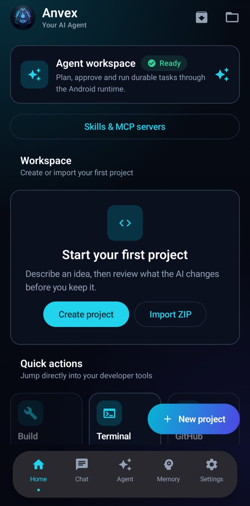
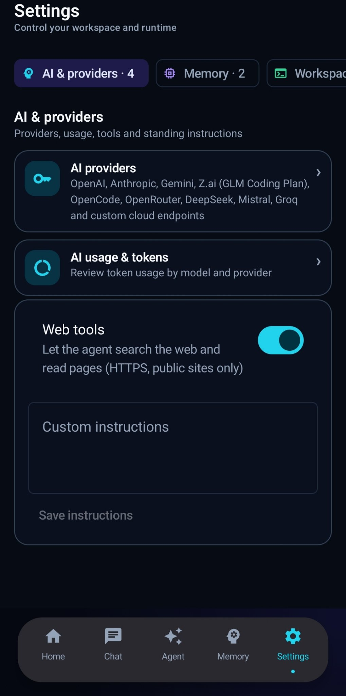
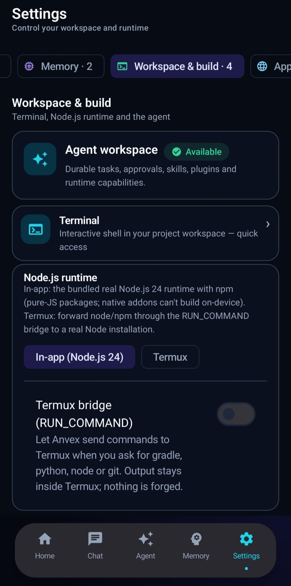
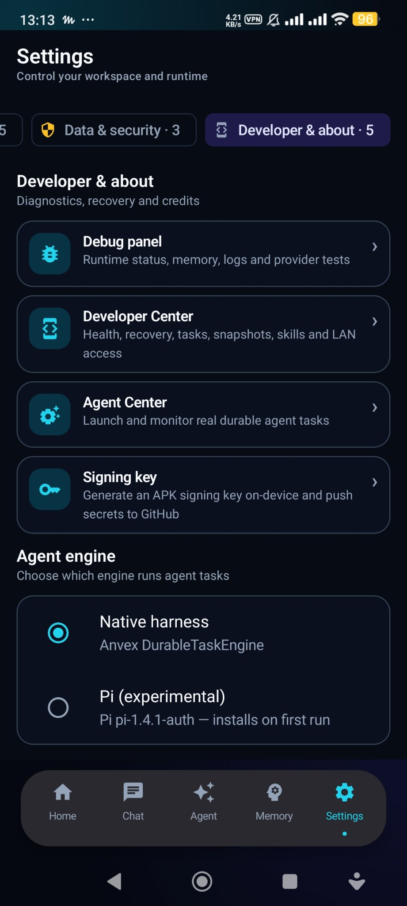
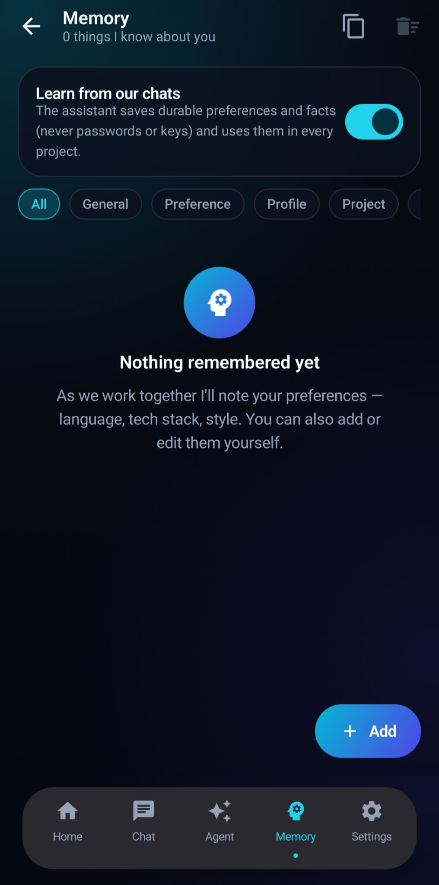

<div align="center">


# ⚡ Anvex

### Your AI app-builder and agent — running entirely on your Android phone

Bring any model. Build real projects. No PC, no backend, no Termux.


**[English](#-english) · [فارسی](#-فارسی)**

</div>

---

<a id="-english"></a>

# 🇬🇧 English

## What is Anvex?

**Anvex** is a standalone Android app that turns your phone into an AI-powered development studio. Describe what you want, and the AI agent writes the project, edits files, previews the result, and packages it for you — **all on-device**.

It started as an Android port of [bolt.diy](https://github.com/stackblitz-labs/bolt.diy) and has grown into a general-purpose, bring-your-own-model agent: plug in **any API key + base URL**, and you get a chat-driven coding workspace with memory, tools, and a real project file system.

**Download:** get the latest signed APK from [Releases](https://github.com/PishiKuchulu/Anvex/releases).

## 📸 Screenshots

| Home — agent workspace | AI & providers | Workspace & build |
|---|---|---|
|  |  |  |

| Developer & about — agent engine | Memory |
|---|---|
|  |  |

## ✨ Features

- 🤖 **Bring any model** — connect OpenAI, Anthropic, Google Gemini, OpenRouter, DeepSeek, Mistral, Groq, or any OpenAI-compatible custom endpoint (API key + URL).
- 💬 **Agentic chat** — the AI plans, creates and edits files, and explains what it did, right inside the conversation.
- 🧠 **Long-term memory** — the agent remembers your preferences, tastes, and past decisions across sessions.
- 📝 **Built-in code editor** — browse the project tree, view and edit files with syntax highlighting.
- 👀 **Live preview** — run and preview web projects instantly in an embedded WebView.
- 📦 **Real file delivery** — export your project as a proper **ZIP** (or PDF) straight to your device, no HTML workarounds.
- 🗂️ **Project workspace** — create a project with just a **name and a folder path**; existing folders with files are accepted.
- 🔄 **GitHub sync** — back up and sync your projects to your own GitHub repository, with a built-in local git.
- 🌍 **English & Persian UI** — full translation with proper RTL support.
- 🔒 **Privacy-first** — your keys and projects stay on your device. No Anvex backend, no telemetry servers.

<div align="center">
  
</div>

## 🧱 Tech Stack

| Layer | Technology |
|---|---|
| Language | Kotlin |
| UI | Jetpack Compose (Material 3) |
| Architecture | Clean Architecture, multi-module |
| Preview | Android WebView |
| AI access | HTTP/SSE streaming to any OpenAI-style or native provider API |

Package name: `com.anvex.app`

## 🚀 Getting Started

### Requirements
- Android Studio (latest stable) with JDK 17
- An Android device or emulator
- An API key (or a local server URL) for at least one AI provider

### Build from source

```bash
git clone https://github.com/PishiKuchulu/Anvex.git
cd Anvex
./gradlew assembleDebug
```

The APK will be at `app/build/outputs/apk/debug/`.

Or open the project in Android Studio and press **Run ▶**.

### First run
1. Open **Providers** and add a provider (API key + base URL).
2. Pick a model and start a **New Project** (name + folder).
3. Chat with the agent: *"Build me a landing page for my coffee shop."*
4. Preview it, edit files, and **export as ZIP** when you're done.

## 🔌 Supported Providers

| Provider | Type |
|---|---|
| OpenAI | Cloud |
| Anthropic | Cloud |
| Google Gemini | Cloud |
| OpenRouter | Cloud (multi-model gateway) |
| DeepSeek · Mistral · Groq | Cloud |
| Custom endpoint | Any OpenAI-compatible API (cloud, or a local server over loopback `http://` / any `https://` — Android blocks cleartext `http://` to LAN addresses, so a PC Ollama instance needs an `https://` URL or a tunnel) |

## 🛡️ Security & Privacy

- API keys are stored locally on-device, encrypted with a device key.
- There is **no Anvex backend and no telemetry** — but "nothing leaves the
  device except your AI provider" would not be honest either. The network
  features, each used only when you use it:
  - the AI provider **you** configure (your chats, code and prompts go there);
  - optional agent web tools — search via DuckDuckGo's HTML endpoint and
    page fetching — when the agent uses them or you ask it to;
  - the live preview can load the libraries your web project references
    (e.g. esm.sh) and npm installs contact the npm registry, like any
    Node tool;
  - the Python sandbox downloads its Pyodide runtime from jsDelivr;
  - update checks read this repository's public releases on GitHub, and
    GitHub sync talks to api.github.com with your own token — only when
    you set it up and press sync.
- The app has gone through multiple security-hardening and code-audit passes.
- **Nightly debug builds are signed with a publicly known debug key.**
  The rolling debug APK (tag `latest`, package `com.anvex.app.debug`) is
  signed with the committed `keystore/debug.keystore` so that each nightly
  installs over the previous one — that keystore's private key is in this
  public repository, so anyone can sign an APK that Android treats as an
  update to a debug install (and that would inherit its data). Install
  nightly debug builds only from this repository's own releases, and do
  not keep sensitive projects in a debug install. Versioned releases
  (`vX.Y.Z`) are signed with a private release key and are unaffected;
  the in-app updater only ever offers those versioned releases.

Found a vulnerability? Please open a private security advisory on GitHub instead of a public issue.

## 🗺️ Roadmap

- [ ] More agent tools and automation
- [ ] More UI languages

Ideas and feature requests are welcome — open an issue!

## 🤝 Contributing

1. Fork the repository
2. Create a branch: `git checkout -b feature/my-feature`
3. Commit your changes: `git commit -m "Add my feature"`
4. Push and open a Pull Request

## 📄 License

MIT — see the [LICENSE](LICENSE) file.

## 👤 Credits

**Developer Farzad Sholeh**

Inspired by [bolt.diy](https://github.com/stackblitz-labs/bolt.diy).

---

<a id="-فارسی"></a>

<div dir="rtl" align="right">

# 🇮🇷 فارسی

## معرفی Anvex

اپلیکیشن **Anvex** گوشی شما را به یک استودیوی توسعه با هوش مصنوعی تبدیل می‌کند. فقط بگویید چه می‌خواهید؛ ایجنت هوش مصنوعی پروژه را می‌نویسد، فایل‌ها را ویرایش می‌کند، نتیجه را پیش‌نمایش می‌دهد و خروجی را برایتان بسته‌بندی می‌کند — **همه‌چیز روی خود گوشی**.

این پروژه با پورت اندرویدی [bolt.diy](https://github.com/stackblitz-labs/bolt.diy) شروع شد و حالا به یک ایجنت عمومی با قابلیت «مدل دلخواه خودتان» تبدیل شده است: **هر کلید API و آدرسی (URL)** را وارد کنید و یک محیط کدنویسی چت‌محور با حافظه، ابزارها و فایل‌سیستم واقعی پروژه داشته باشید.

**دانلود:** آخرین نسخه امضاشده را از بخش [Releases](https://github.com/PishiKuchulu/Anvex/releases) بگیرید.

## 📸 اسکرین‌شات‌ها

| خانه — فضای کاری ایجنت | هوش مصنوعی و ارائه‌دهنده‌ها | فضای کاری و بیلد |
|---|---|---|
|  |  |  |

| توسعه‌دهنده — موتور ایجنت | حافظه |
|---|---|
|  |  |

## ✨ ویژگی‌ها

- 🤖 **هر مدلی که بخواهید** — اتصال به OpenAI، Anthropic، Google Gemini، OpenRouter، DeepSeek، Mistral، Groq یا هر سرویس سفارشی سازگار با OpenAI (با کلید API + URL).
- 💬 **چت ایجنتی** — هوش مصنوعی برنامه‌ریزی می‌کند، فایل می‌سازد و ویرایش می‌کند و کارش را داخل همان گفتگو توضیح می‌دهد.
- 🧠 **حافظه بلندمدت** — ایجنت سلیقه، ترجیحات و تصمیم‌های قبلی شما را بین جلسه‌ها به خاطر می‌سپارد.
- 📝 **ادیتور کد داخلی** — مرور درخت پروژه، مشاهده و ویرایش فایل‌ها با رنگ‌بندی کد.
- 👀 **پیش‌نمایش زنده** — اجرای فوری پروژه‌های وب در WebView داخلی.
- 📦 **تحویل واقعی فایل** — خروجی **ZIP** (یا PDF) مستقیم روی گوشی، بدون ترفند فایل HTML.
- 🗂️ **فضای کاری پروژه** — برای ساخت پروژه فقط **نام و مسیر پوشه** کافی است؛ پوشه‌ای که از قبل فایل دارد هم پذیرفته می‌شود.
- 🔄 **همگام‌سازی با GitHub** — پشتیبان‌گیری و سینک پروژه‌ها با مخزن گیت‌هاب خودتان، همراه با گیت محلی داخلی.
- 🌍 **رابط فارسی و انگلیسی** — ترجمه کامل با پشتیبانی درست از راست‌به‌چپ (RTL).
- 🔒 **حریم خصوصی** — کلیدها و پروژه‌ها روی گوشی شما می‌مانند. بدون سرور و بدون ردیابی.

## 🧱 فناوری‌ها

| بخش | فناوری |
|---|---|
| زبان | Kotlin |
| رابط کاربری | Jetpack Compose (Material 3) |
| معماری | Clean Architecture، چندماژولی |
| پیش‌نمایش | Android WebView |
| دسترسی به AI | ارتباط HTTP/SSE با API هر ارائه‌دهنده |

نام پکیج: `com.anvex.app`

## 🚀 شروع کار

### پیش‌نیازها
- Android Studio نسخه پایدار اخیر همراه با JDK 17
- یک گوشی اندرویدی یا شبیه‌ساز
- کلید API (یا آدرس سرور محلی) حداقل یک ارائه‌دهنده هوش مصنوعی

### ساخت از سورس

```bash
git clone https://github.com/PishiKuchulu/Anvex.git
cd Anvex
./gradlew assembleDebug
```

فایل APK در مسیر `app/build/outputs/apk/debug/` ساخته می‌شود. یا پروژه را در Android Studio باز کنید و **Run ▶** بزنید.

### اولین اجرا
1. از بخش **ارائه‌دهنده‌ها** یک سرویس اضافه کنید (کلید API + URL).
2. مدل را انتخاب کنید و یک **پروژه جدید** بسازید (نام + پوشه).
3. با ایجنت گفتگو کنید: *«یک صفحه فرود برای کافه من بساز.»*
4. پیش‌نمایش بگیرید، فایل‌ها را ویرایش کنید و در پایان **خروجی ZIP** بگیرید.

## 🔌 ارائه‌دهنده‌های پشتیبانی‌شده

| ارائه‌دهنده | نوع |
|---|---|
| OpenAI | ابری |
| Anthropic | ابری |
| Google Gemini | ابری |
| OpenRouter | ابری (درگاه چندمدلی) |
| DeepSeek · Mistral · Groq | ابری |
| Endpoint سفارشی | هر API سازگار با OpenAI (ابری یا سرور محلی) |

## 🛡️ امنیت و حریم خصوصی

- کلیدهای API فقط روی خود دستگاه ذخیره می‌شوند.
- داده‌ها فقط به ارائه‌دهنده‌ای که **خودتان** تنظیم کرده‌اید ارسال می‌شود.
- برنامه چند مرحله سخت‌سازی امنیتی و بازبینی کد را گذرانده است.

اگر آسیب‌پذیری پیدا کردید، لطفاً به‌جای Issue عمومی، از بخش Security Advisory در GitHub به‌صورت خصوصی گزارش دهید.

## 🗺️ نقشه راه

- [ ] ابزارها و اتوماسیون بیشتر برای ایجنت
- [ ] مدیریت بهتر حافظه (مشاهده / ویرایش / پاک‌کردن)
- [ ] قالب‌های آماده پروژه
- [ ] زبان‌های بیشتر برای رابط کاربری

پیشنهادها و ایده‌هایتان خوش‌آمد است — یک Issue باز کنید!

## 🤝 مشارکت

1. مخزن را Fork کنید
2. یک شاخه بسازید: `git checkout -b feature/my-feature`
3. تغییرات را Commit کنید: `git commit -m "Add my feature"`
4. Push کنید و Pull Request بفرستید

## 📄 مجوز

مجوز MIT — فایل [LICENSE](LICENSE) را ببینید.

## 👤 سازنده

توسعه‌دهنده: **Farzad Sholeh**

الهام‌گرفته از [bolt.diy](https://github.com/stackblitz-labs/bolt.diy).

</div>
