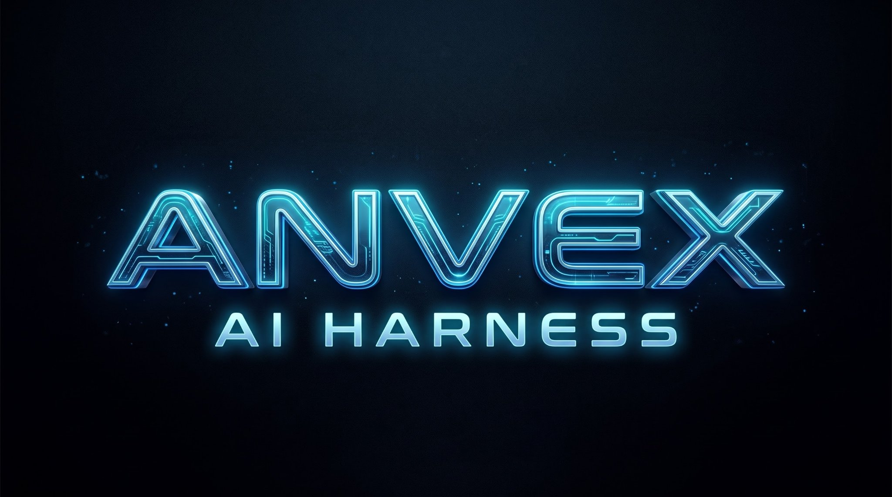
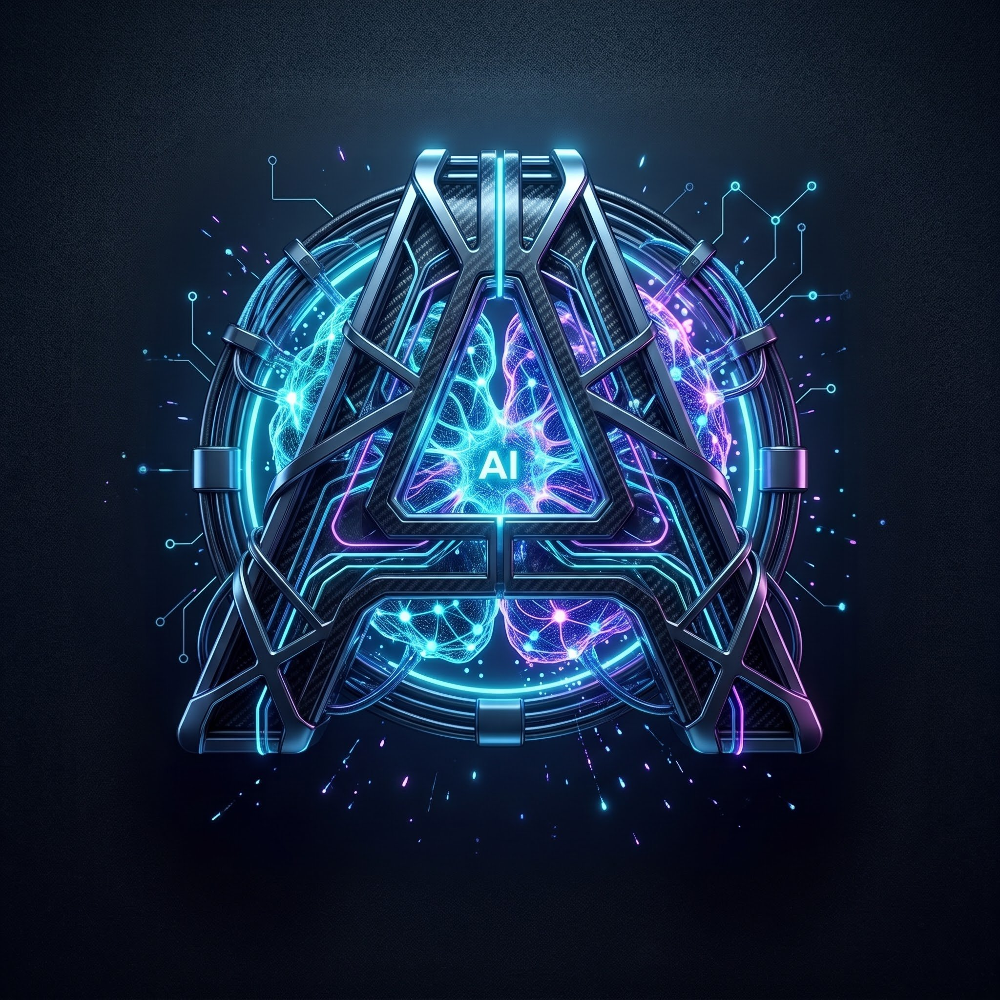

<p align="center">
  
</p>

<p align="center">
  <a href="https://github.com/PishiKuchulu/Anvex/actions/workflows/build-apk.yml"></a>
  
  
  
</p>

<p align="center"><b>Command Deck for your code</b></p>

**Anvex** is a full **AI coding-agent environment that lives on your Android phone**:
chat with an agent that writes real files, run shell commands in an interactive
terminal, preview web apps in an embedded browser, keep everything in a real local
git — and even build APKs without leaving the app. A standalone Android port of
[bolt.diy](https://github.com/stackblitz-labs/bolt.diy) (MIT), rebuilt around a
durable on-device agent loop.

> Your phone is no longer just a viewer for your code. It's the deck you command it from.

<p align="center">
  
</p>

---

<div dir="rtl">

# انوکس — میز فرمانِ کدِ شما

**انوکس** یک محیط کامل **ایجنت کدنویسی هوش مصنوعی روی گوشی اندرویدی شماست**:
با ایجنتی چت کنید که فایل‌های واقعی می‌سازد، در ترمینال تعاملی دستور شل اجرا کنید،
وب‌اپ‌ها را در مرورگر داخلی پیش‌نمایش بگیرید، همه‌چیز را در یک گیتِ واقعیِ روی دستگاه
نگه دارید — و حتی بدون خروج از اپ، APK بیلد کنید. پورتی مستقل از
[bolt.diy](https://github.com/stackblitz-labs/bolt.diy) (تحت لایسنس MIT) برای اندروید،
که حول یک حلقه‌ی ایجنتِ بادوامِ روی دستگاه بازسازی شده است.

> گوشی شما دیگر فقط نمایشگر کدتان نیست؛ میز فرمانی است که از آنجا کدتان را هدایت می‌کنید.

## ✨ چه چیزهایی داخل است

- **💬 چت ایجنت با استریم زنده** — پاسخ‌ها توکن‌به‌توکن می‌آیند؛ مسیر استدلال (thinking) مدل قابل مشاهده است
- **🧩 آرتفکت‌ها** — فایل‌هایی که ایجنت می‌سازد، با دیف، تاریخچه‌ی نسخه‌ها و بازگردانی یک‌تاپه
- **⌨️ ترمینال واقعی** — شل تعاملی روی دستگاه، با بافر مدیریت‌شده و اسکرول نرم
- **🌐 پیش‌نمایش وب** — اجرای وب‌اپ در WebView داخلی، با کنسول
- **🔨 بیلدر APK داخل اپ** — بیلد گریدل روی خود گوشی (با toolchain واردشده)
- **🌿 گیتِ واقعی (GitLite)** — گیت محلی کامل: آبجکت‌ها، ایندکس، refها و reflog
- **🖥️ هارنس** — فضای کاری وبِ سبکِ OpenCode: ایجنت، فایل‌ها، گیت، ترمینال، مهارت‌ها، MCP و بیلد — همه داخل اپ
- **📝 ادیتور** — هایلایت نحوی، undo/redo، جستجو و تب‌ها
- **🧠 حافظه و فایل‌های دانش** — کانتکست ماندگار بین نشست‌ها
- **🔍 جستجوی وب، 🎙️ ورودی صوتی، 🔊 خوانش پاسخ، 🐍 اجرای پایتون** و اتصال عکس/فایل

## 🔌 ارائه‌دهنده‌های هوش مصنوعی

OpenAI، Anthropic، Google Gemini، OpenRouter، DeepSeek، Mistral، Groq،
هر **اندپوینت سفارشی سازگار با OpenAI یا Anthropic**، و **Z.ai (طرح GLM Coding)** —
همه مستقیم از دستگاه به ارائه‌دهنده وصل می‌شوند (بدون سرور واسط). تست اتصال و
فهرست مدل‌ها داخل اپ است.

> در ۴.۴.۴ یکپارچه‌سازی‌های Cline و Antigravity از سطح محصول حذف شدند؛
> سطرهای قدیمی پایگاه‌داده بدون کرش به کلاینت عمومی سازگار با OpenAI برمی‌گردند.

## 🎛️ میز فرمان (۴.۴.۴)

تم پیش‌فرض جدید: **Professional** — سطوح خنثی عمیق، لهجه‌ی آبیِ خویشتن‌دار،
بوردرهای مویی به‌جای گرادیان، گرید ۸pt. کامپوزرِ چت حالا یک *command palette*
است: گلیف مونوی `❯`، سطح ۱۶dp با بوردر مویی، و دکمه‌ی ارسالی که با فنر زنده می‌شود.
تم‌های Nebula، Glass و Aurora همچنان در تنظیمات هستند.

## 🚀 شروع سریع

```
APK را نصب کن → ارائه‌دهنده‌ی AI را وصل کن → به ایجنت بگو چه بسازی → هارنس → پیش‌نمایش → خروجی
```

## 🔧 بیلد از سورس

```bash
# JDK 17 لازم است
./gradlew :app:assembleDebug
# خروجی: app/build/outputs/apk/debug/app-debug.apk
```

هر پوش به `main` در GitHub Actions هم تست‌ها را اجرا می‌کند و هم APK دیباگ را
می‌سازد (برگه‌ی Actions ← آخرین اجرا ← Artifacts).

## 🧱 معماری

| ماژول | نقش |
|---|---|
| `:app` | رابط کاربری (Jetpack Compose)، ناوبری، ViewModelها |
| `:core:model` | مدل‌های داده و قراردادها |
| `:core:engine` | حلقه‌ی ایجنت، اجرای اکشن‌ها، پروتکل استریم boltArtifact |
| `:core:ai` | آداپترهای ارائه‌دهنده‌ها (OpenAI / Anthropic / Gemini، SSE دستی) |
| `:core:android` | Room، DataStore، فایل‌سیستم، پل‌های اندرویدی |

</div>

---

## ✨ What's inside

- **💬 Agent chat with live streaming** — tokens arrive as they're generated; the model's thinking trace is inspectable
- **🧩 Artifacts** — files the agent creates, with diff, version history and one-tap restore
- **⌨️ A real terminal** — interactive on-device shell with a managed buffer and smooth scrolling
- **🌐 Web preview** — run web apps in the embedded WebView, with a console
- **🔨 In-app APK builder** — Gradle builds on the phone itself (via an imported toolchain)
- **🌿 Real git (GitLite)** — full local git: loose objects, DIRC index, refs and reflogs
- **🖥️ Harness** — an OpenCode-style web workspace: agent, files, git, terminal, skills, MCP and build — all inside the app
- **📝 Editor** — syntax highlighting, undo/redo, search and tabs
- **🧠 Memory & knowledge files** — persistent context across sessions
- **🔍 Web search, 🎙️ voice input, 🔊 read-aloud, 🐍 Python execution**, file/image attachments

## 🔌 AI providers

OpenAI, Anthropic, Google Gemini, OpenRouter, DeepSeek, Mistral, Groq,
any **custom OpenAI- or Anthropic-compatible HTTPS endpoint**, and
**Z.ai (GLM Coding Plan)** — all connected device→provider directly, no middle
server. Connection testing and model listing are built in.

> In 4.4.4 the Cline and Antigravity integrations were removed from the product
> surface; legacy database rows decode without crashing and fall back to the
> generic OpenAI-compatible client.

## 🎛️ Command Deck (4.4.4)

The new default theme: **Professional** — deep neutral surfaces, a restrained blue
accent, hairline borders over gradients, an 8pt grid. The chat composer is now a
*command palette*: a mono `❯` prompt glyph, a 16dp hairline-bordered surface, and
a send key that springs alive when a command is ready. Nebula, Glass and Aurora
themes remain in Settings.

## 🚀 Quick start

```
Install APK → Connect your AI provider → Tell the agent what to build → Harness → Preview → Export
```

## 🔧 Build from source

```bash
# JDK 17 required
./gradlew :app:assembleDebug
# Output: app/build/outputs/apk/debug/app-debug.apk
```

Every push to `main` runs the unit tests and builds a debug APK on GitHub Actions
(Actions tab → latest run → Artifacts).

## 🧱 Architecture

| Module | Role |
|---|---|
| `:app` | UI (Jetpack Compose), navigation, ViewModels |
| `:core:model` | Data models and contracts |
| `:core:engine` | Agent loop, action execution, boltArtifact stream protocol |
| `:core:ai` | Provider adapters (OpenAI / Anthropic / Gemini, hand-written SSE) |
| `:core:android` | Room, DataStore, filesystem, Android bridges |

## 📄 License

MIT — see [LICENSE](LICENSE).
